<h1 align="center">致谢 · 本项目的学习与参考来源</h1>

<strong>SUSTechMobile 的 iOS 移植建立在上游项目公开分享的校园服务研究与实现经验之上。</strong>

<h2 align="center"><a href="https://github.com/dumixthestpd/sustech-mobile">sustech-mobile</a> &nbsp; · &nbsp; <a href="https://github.com/dumixthestpd/sustech_survival">sustech_survival</a></h2>

原作者：<a href="https://github.com/dumixthestpd"><strong>dumixthestpd</strong></a> 感谢原作者公开源码、整理校园接口，并分享校园工具的实现经验。

| 学习与参考项目 | 对本项目的帮助 |
| --- | --- |
| **[sustech-mobile](https://github.com/dumixthestpd/sustech-mobile)** | Android 校园事务聚合应用；本项目学习其功能设计、校园服务访问方式与业务流程，并以此作为逐步对齐 iOS 功能的参考。 |
| **[sustech_survival](https://github.com/dumixthestpd/sustech_survival)** | 校园服务接口与流程资料；帮助本项目理解学校系统的认证方式、接口约定和数据含义。 |

**本项目在学习上述项目的基础上，以 Swift / SwiftUI 编写 iPhone 与 iPad 移植实现。相关协议、字段解释与业务行为具有上游来源，语言重写不消除原项目的许可和署名义务。** 完整参考证据见 [接口来源记录](docs/FEATURE_EVIDENCE.md)，许可与署名见 [LICENSE](LICENSE) 和 [NOTICE](NOTICE)。也感谢 [wormforce/sustech-cli](https://github.com/wormforce/sustech-cli) 提供的校园接口访问与数据解释参考。

---

  

<h1 align="center">SUSTechMobile</h1>

<strong>把南科大的日常，装进 iPhone 和 iPad。</strong>

课程与截止日期 · 校园卡与校车 · 打印与预约 · 校园活动

  
  
  
  

  <a href="https://github.com/aNother1332/sustech-mobile-ios/releases/latest"><strong>下载体验</strong></a> ·
  <a href="#校园日常一处查看">功能亮点</a> ·
  <a href="#看看实际界面">界面预览</a> ·
  <a href="#开始使用">安装指南</a> ·
  <a href="https://github.com/aNother1332/sustech-mobile-ios/issues">反馈建议</a>

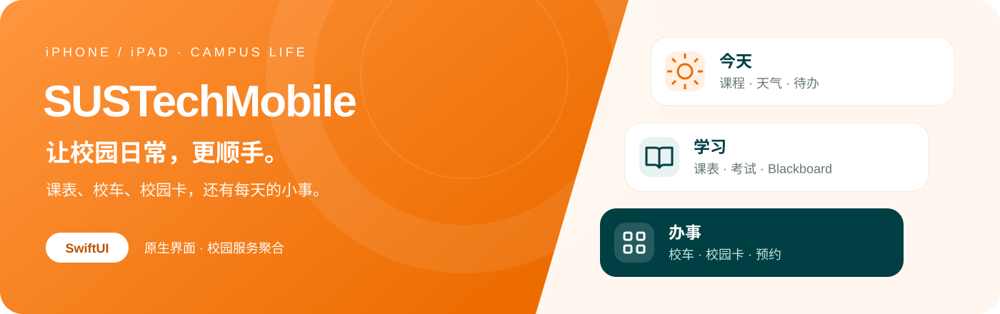

**SUSTechMobile** 是面向南方科技大学同学的非官方校园事务聚合应用，以 Swift / SwiftUI 为 iPhone 和 iPad 编写。打开首页看今天的课、近期考试和作业截止日期；出门前查校车，办事时找打印、预约与请假入口，让分散的校园信息更容易找到。

当前版本 **1.0.0 · build 17**，最低支持 **iOS / iPadOS 17**。采用非商业许可开源，学校服务与规则以官方系统为准。

## 校园日常，一处查看

<table>
  <tr>
    <td width="50%"><h3>☀️ 今天，先看重要的</h3>
教学周、今日课程、最近考试和待交作业汇在首页。余额卡片直达校园卡，待办卡片直达日程，校园天气完整展示在页面底部。
</td>
    <td width="50%"><h3>📚 学习，按自己的节奏</h3>
周课表、考试、成绩和 Blackboard 集中查看。下载课件随时阅读，折叠已结束课程，让它们的作业截止日期退出首页提醒。
</td>
  </tr>
  <tr>
    <td><h3>🚌 出门前，看看车到哪了</h3>
Apple 地图展示校园线路、站台与车辆位置，同时查看内外环最近站台的到站预测；点车辆或站台看浮卡，向上拉起当天时刻表。
</td>
    <td><h3>💳 校园卡，收支看得清</h3>
原生查看余额、近期账单和按日消费曲线，支持本地范围筛选。充值提供支付宝、微信渠道入口，付款在对应平台完成。
</td>
  </tr>
  <tr>
    <td><h3>🗓️ 办事，从这里出发</h3>
IC 房间与时间网格、CLE 辅导、书院场地集中在预约中心；请假记录原生查看，申请进入学校完整表单。还有校园活动、日程和教学日历。
</td>
    <td><h3>🔎 校园信息，随手查</h3>
空教室课程占用、教师院系与联系方式、交换项目、培养方案和 NCES 课程评价。查资料、找老师、了解课程，都有对应入口。
</td>
  </tr>
</table>

## 看看实际界面

以下为项目运行中的 iPhone／iPad 模拟器截图，展示资料使用虚构样例或公开信息。首页与办事来自 **1.0.0**；其余选用较早版本的对应业务页面，标注在各组下方。截图展示界面，不代表所有业务已经完成真机验收。点击图片可查看大图；[完整图库与历史设计](docs/SCREENSHOTS.md) · [逐图构建来源](docs/screenshots/SOURCES.json)。

### 从今天开始

<table>
  <tr><th width="33%">今天 · 1.0.0</th><th width="33%">学习 · 0.9.0</th><th width="33%">办事 · 1.0.0</th></tr>
  <tr>
    <td>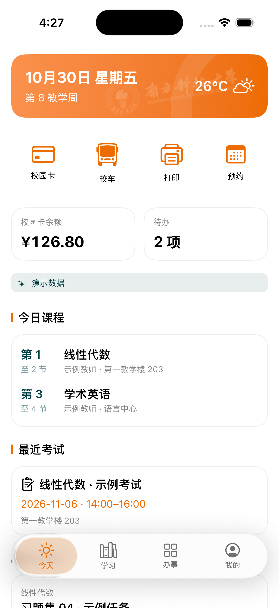</td>
    <td>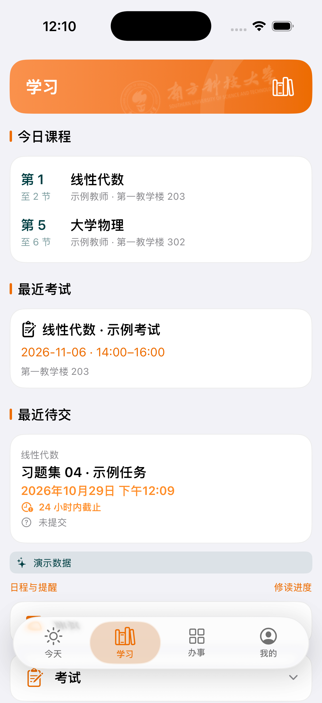</td>
    <td>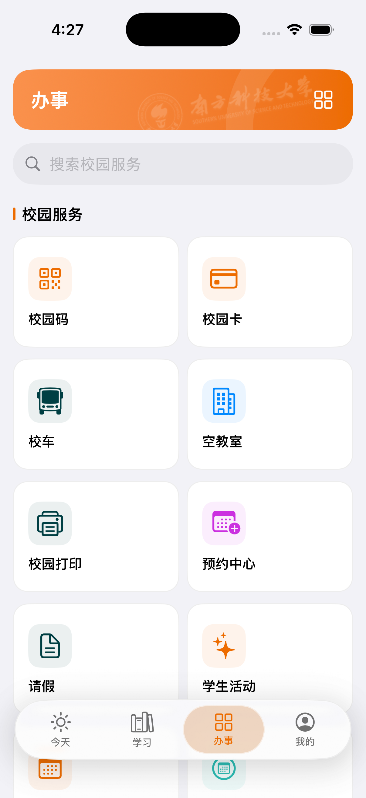</td>
  </tr>
</table>

### 上课、赶车、安排校园生活

<table>
  <tr><th width="33%">周课表 · 0.9.0</th><th width="33%">校园巴士 · 0.7.0</th><th width="33%">IC 讨论间 · 0.11.0</th></tr>
  <tr>
    <td>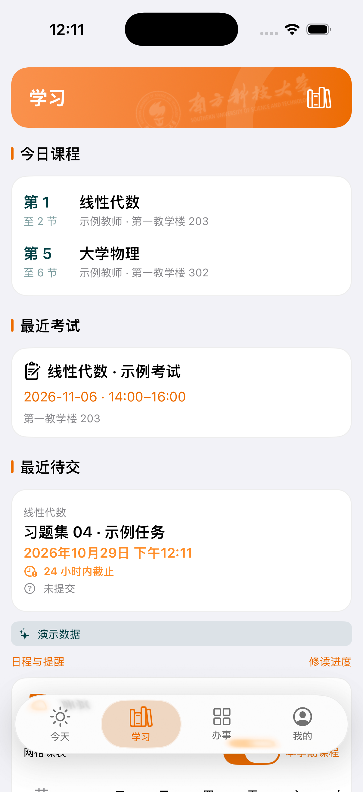</td>
    <td>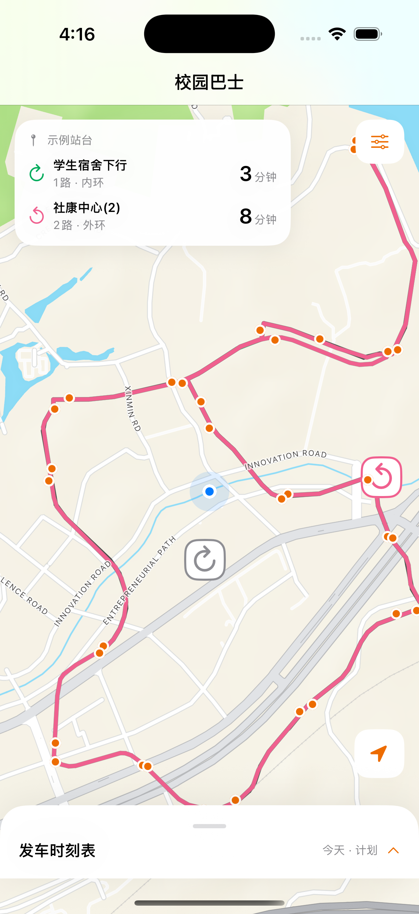</td>
    <td>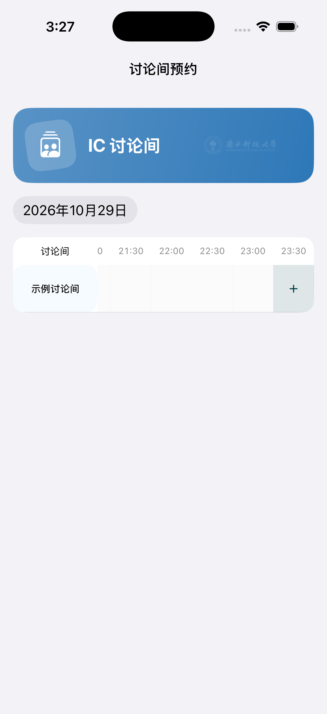</td>
  </tr>
</table>

### 不止查课表

<table>
  <tr><th width="33%">校园卡 · 0.10.0</th><th width="33%">请假记录 · 0.11.0</th><th width="33%">学生活动 · 0.11.0</th></tr>
  <tr>
    <td>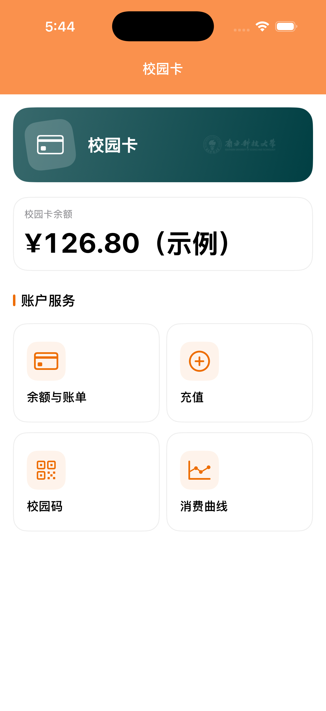</td>
    <td>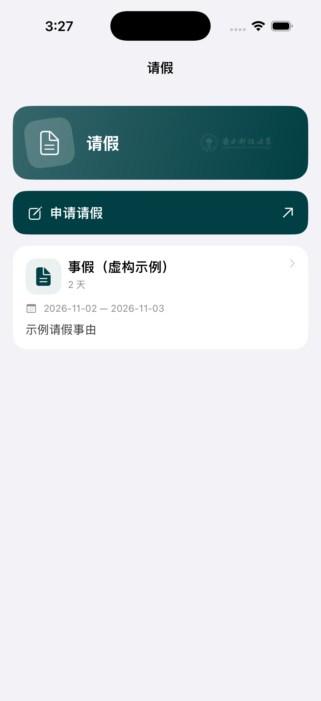</td>
    <td>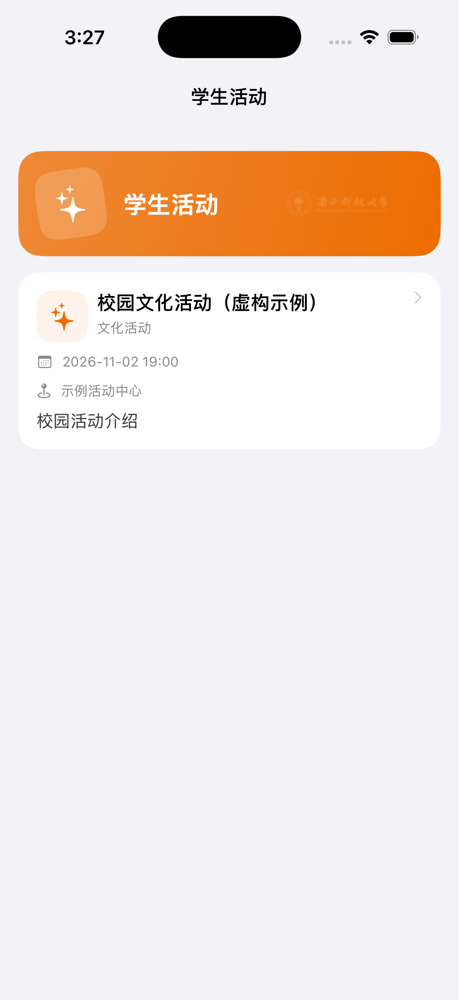</td>
  </tr>
</table>

### 找到信息，再做决定

<table>
  <tr><th width="33%">课程评价 · 0.10.0</th><th width="33%">培养方案 · 0.11.0</th><th width="33%">交换项目 · 0.10.0</th></tr>
  <tr>
    <td>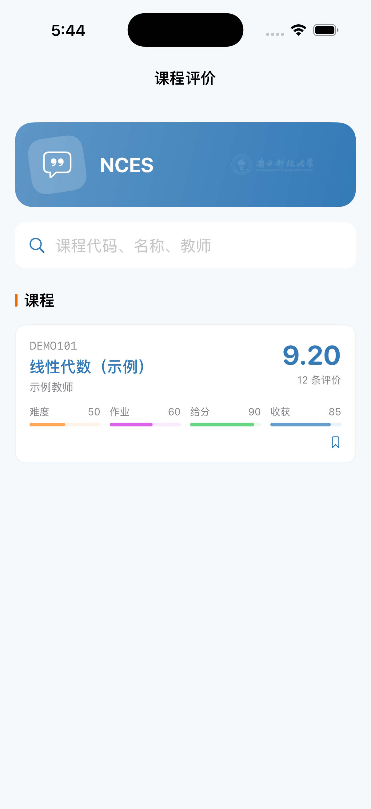</td>
    <td>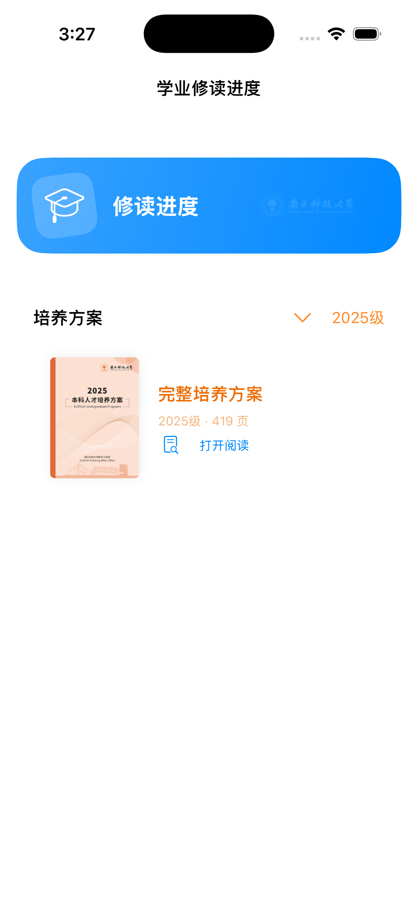</td>
    <td>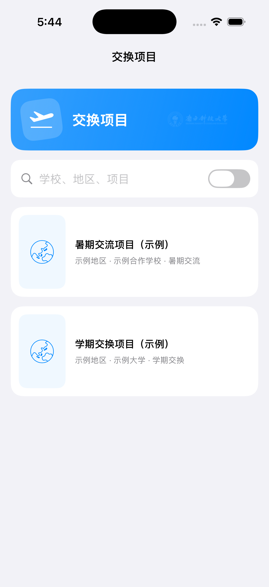</td>
  </tr>
</table>

## 熟悉的校园，也有熟悉的手感

**南科大橙 `#ED6C00` · 墨绿 `#003F43` · 天青 `#2BBCB3`**。配色参考[学校官方标识](https://www.sustech.edu.cn/zh/school_logo.html)，橙白页头与轻量卡片贯穿首页和服务目录，各业务内容页再参考对应学校网页布局。应用图标保留校徽中央火炬，页头融入学校标识元素。

- **苹果系统字体与原生界面**：SwiftUI 构建，支持深色模式与系统大字号。
- **地图成为校车页的主体**：浮卡查看车辆与站台，手势抽屉承载时刻表。
- **iPad 也有自己的空间**：支持宽屏布局，课程、入口与摘要在大屏上展开。
- **尽量少打断**：复用有效会话，支持下拉刷新；确认登录失效时再提示。

<table>
  <tr><th>iPad · 今天 · 1.0.0</th><th>iPad · 办事 · 1.0.0</th></tr>
  <tr>
    <td>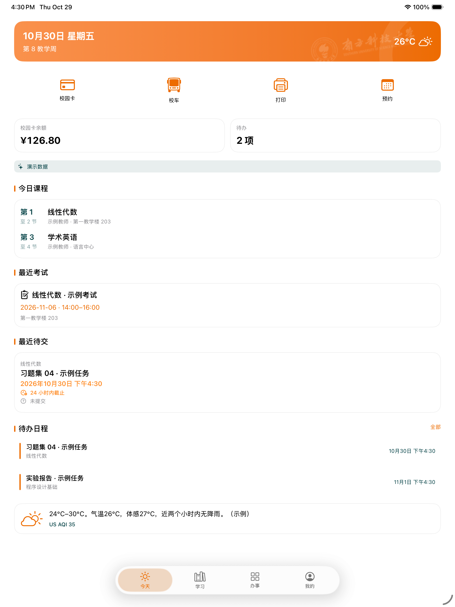</td>
    <td>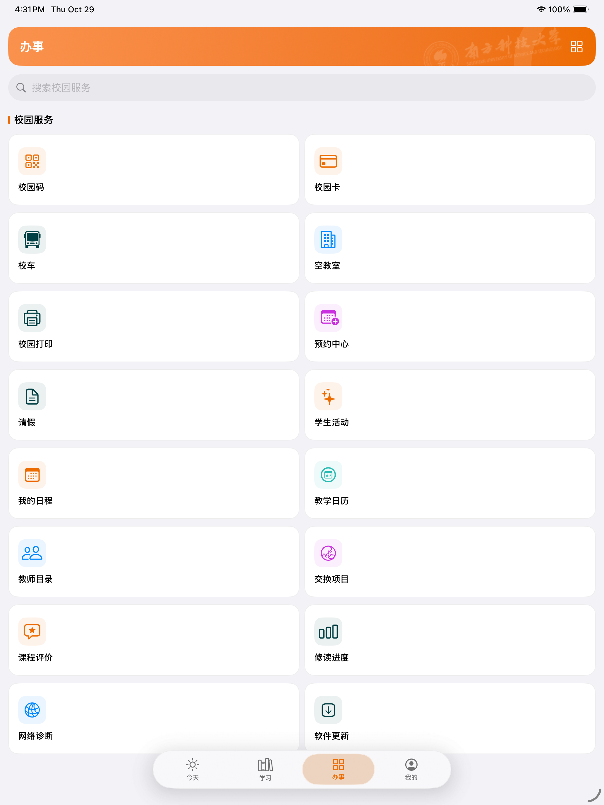</td>
  </tr>
</table>

## 功能一览

| 场景 | 可以做什么 |
| --- | --- |
| 每日总览 | 教学周、课程、考试、待交作业、余额、日程、天气与空气质量 |
| 学习管理 | 周课表、考试、成绩与 GPA 记录试算、Blackboard 课程／公告／任务／课件、课程折叠 |
| 学习资料 | 课件下载、Quick Look 预览、系统分享、官方培养方案 PDF |
| 校园出行 | 校车位置、线路轨迹、分方向站台预测、车辆与站台浮卡、当天时刻表 |
| 校园卡 | 余额、近期账单、范围筛选、按日消费曲线、外部充值渠道入口 |
| 校园打印 | PDF 导入、纸张／颜色／单双面／份数／页码设置、上传、任务队列、站点信息 |
| 预约与请假 | IC 房间时间网格、CLE、书院场地、我的预约；本人请假记录与学校申请表 |
| 信息查询 | 教学日历、课程占用查询、教师院系筛选与联系方式、NCES 评价、交换项目、学生活动 |
| 个人与提醒 | 学校真实个人资料、我的预约、下载文件、日程提醒、分区设置 |
| 登录与缓存 | 原生 CAS、可选记住密码、业务会话自动续接、本机缓存 |

### 当前使用范围

日常查询与界面已实现，部分业务仍需要实际校园环境与设备验证。为方便选择，这里集中列出主要边界；[完整功能与验证清单](docs/CAPABILITIES.md)记录每个模块的情况。

| 功能 | 当前范围 |
| --- | --- |
| 充值 | 支付宝／微信入口可用；付款与金额由外部平台处理，**完整原生充值下单尚未开放**。 |
| 打印 | 使用独立打印平台密码，受校园网络限制；有效账号打印流程仍待真机验收。 |
| 预约与 BB 提交 | 已有对应实现，真实写入仍待逐项设备验收；不包含体育场馆或自动抢场。BB 提交仅覆盖 Original 个人单文件等限定场景。 |
| 空教室 | 旧目录异常时使用全校课表判断课程占用，不覆盖临时借用。 |
| 请假与活动 | 请假记录、活动浏览为原生；请假申请沿用学校表单，活动暂不提供报名。 |
| 扩展与预测 | 小组件和分享打印为可选实验扩展，需要适用签名；校车 ETA 为预测信息。 |

## 开始使用

### 下载到 iPhone 或 iPad

1. 前往 **[最新 Release](https://github.com/aNother1332/sustech-mobile-ios/releases/latest)**，下载普通包 `SUSTechMobile-unsigned.ipa`。
2. 使用 iLoader 等适用工具，以自己的 Apple 账号在本地签名并安装。**Windows 也可以安装，无需自己拥有 Mac。**
3. 在应用中登录校园账号，按需开启“记住账号密码并自动登录”，开始同步课程与校园信息。

IPA 是未签名真机包，需要侧载签名；当前没有 App Store 或 TestFlight 下载。免费 Apple 账号的签名有效期与设备限制仍适用。实验扩展包需另行验证签名兼容性，日常使用建议选择普通包。

[下载 1.0.0 普通 IPA](https://github.com/aNother1332/sustech-mobile-ios/releases/download/v1.0.0/SUSTechMobile-unsigned.ipa) · [本版更新说明](docs/RELEASE_1_0.md) · [历史版本](https://github.com/aNother1332/sustech-mobile-ios/releases) · [Windows 安装说明](docs/WINDOWS_SIDELOAD.md)

### 账号留在自己的设备上

校园认证由客户端直接连接学校 HTTPS 服务。应用没有代收校园密码的聚合服务器；原生登录默认不保存密码，主动开启记住功能后，凭据保存在本机 iOS 钥匙串，不跨设备同步。

优先复用现有会话，确认失效后尝试续接；学校要求验证码、拒绝密码或触发限流时暂停自动尝试。学校系统间的独立授权仍受各平台规则限制。账号管理在“我的 → 设置”中；课表、成绩与下载文件可缓存在本机。

## 一起把校园工具做好

本项目持续完善校园服务的原生体验。欢迎提交 [Issue](https://github.com/aNother1332/sustech-mobile-ios/issues) 或 Pull Request：描述系统版本、应用版本、操作步骤和预期结果，附上脱敏截图即可。请不要上传密码、验证码、Cookie、真实学号或成绩。

| 想了解什么 | 从这里开始 |
| --- | --- |
| 具体功能是否完成、如何验证 | [功能与验证范围](docs/CAPABILITIES.md) · [设备验收清单](docs/DEVICE_TESTING.md) |
| 更多截图与过去的设计 | [完整界面图库](docs/SCREENSHOTS.md) · [截图来源](docs/screenshots/SOURCES.json) |
| 在 Mac 或 Windows 上构建 | [开发与构建指南](docs/DEVELOPMENT.md) |
| 学校接口与实现依据 | [接口来源记录](docs/FEATURE_EVIDENCE.md) · [接口说明](docs/INTERFACES.md) |
| 后续规划与版本记录 | [功能路线图](docs/FEATURE_ROADMAP.md) · [1.0.0 发布说明](docs/RELEASE_1_0.md) |

使用 Xcode 26.0+ 构建；无第三方 iOS 包依赖。核心协议与解析位于 `Sources/CampusCore`，SwiftUI 界面位于 `App`，测试与打包脚本随源码提供。没有本地 Mac 时，可使用仓库的手动 GitHub Actions 工作流构建，再在 Windows 上签名安装。

## 来源与许可

本项目学习 **[sustech-mobile](https://github.com/dumixthestpd/sustech-mobile)** 与 **[sustech_survival](https://github.com/dumixthestpd/sustech_survival)** 的校园服务研究和实现经验，以 Swift / SwiftUI 编写 iOS 移植；协议、字段含义和业务行为保留上游依据。也感谢 [sustech-cli](https://github.com/wormforce/sustech-cli)、[SUSTech CRA / sustech-online-ng](https://github.com/sustech-cra/sustech-online-ng) 等公开项目及数据来源。

采用 **[PolyForm Noncommercial License 1.0.0](LICENSE)**，完整署名、数据来源及相关声明见 [NOTICE](NOTICE)。学校校徽、校名与相关标识权利归南方科技大学，[图标来源](Design/Branding/README.md)另有记录。本项目为非官方校园工具，不代表学校或获得学校背书。

---

<strong>SUSTechMobile · 让校园日常，更顺手。</strong> iPhone &amp; iPad · SwiftUI · Made for campus life

